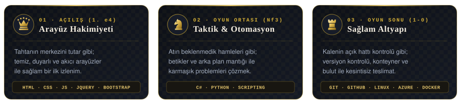

<div align="center">



<br/><br/>


### ♔ TAŞ DİZİLİMİ & TEKNOLOJİ CEPHANELİĞİ

<table>
  <tr>
    <th align="center">♛ VEZİR · FRONTEND</th>
    <th align="center">♞ AT · BACKEND &amp; SCRIPTING</th>
    <th align="center">♜ KALE · ORTAM &amp; ALTYAPI</th>
  </tr>
  <tr>
    <td align="center" valign="middle">
      <sub><i>Tahtanın her yönüne hükmeden arayüzler</i></sub>
      <br/><br/>
      
    </td>
    <td align="center" valign="middle">
      <sub><i>Keskin hamleler ve güçlü otomasyon</i></sub>
      <br/><br/>
      
    </td>
    <td align="center" valign="middle">
      <sub><i>Sağlam hatlar, sürüm ve bulut kontrolü</i></sub>
      <br/><br/>
      
    </td>
  </tr>
</table>

<br/>


### ♚ OYUN PLANI & GELİŞTİRME STRATEJİSİ



<br/>


</div>

```bash
ekrem@grandmaster:~$ whoami
> Ekrem Tezcan Sarıdağ (Frontend Developer)

ekrem@grandmaster:~$ game --status
> AÇILIŞ     : 1. e4 — Temiz Kod & Modern Arayüz
> BAĞLANTI   : [ ████████████████ ] 100% (AKTİF)
> FRONTEND   : HTML · CSS · JS · jQuery · Bootstrap
> TAKTİK     : C# · Python · Otomasyon
> ALTYAPI    : Git · GitHub · Linux · Azure · Docker
> DÖNGÜ      : KODLA. GELİŞTİR. MAT ET. TEKRARLA.
```

<br/>

<div align="center">


</div>
