<div align="center">



</div>

<br/>

---

### Teknolojiler

**Frontend**

<p>
  
</p>

**Backend & Scripting**

<p>
  
</p>

**Ortam & Araçlar**

<p>
  
</p>

---

```bash
ekrem@dev:~$ whoami
Ekrem Tezcan Sarıdağ — Frontend Developer

ekrem@dev:~$ ls ~/pinned
YakitRadar/   stockfish-review/   dijital-arsiv/   SonicTube/
```

<br/>

<p align="left">
  <a href="https://github.com/EkremTezcanSaridag" target="_blank">
    
  </a>
  <a href="https://instagram.com/ekremtezcansaridag" target="_blank">
    
  </a>
</p>
