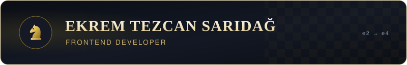

<div align="center">



</div>

---

### ♟️ Profilimde Satranç Oyna

<!-- CHESS_START -->
<div align="center">


<sub>Oyun #1 · İlk hamleyi yapmak için aşağıdan bir kare seç · <a href="https://github.com/EkremTezcanSaridag/EkremTezcanSaridag/issues/new?title=chess%7Cnew&body=Yeni+bir+satran%C3%A7+oyunu+ba%C5%9Flatmak+i%C3%A7in+sadece+%2A%2ACreate%2A%2A+butonuna+t%C4%B1kla%21+%E2%99%9F%EF%B8%8F">↻ Sıfırla</a></sub>

<sub><b>Sıra Beyaz'da</b> — Hamleye tıkla, açılan Issue'da <b>Create</b> butonuna bas:</sub>

♘ `b1`: [a3](https://github.com/EkremTezcanSaridag/EkremTezcanSaridag/issues/new?title=chess%7Cmove%7Cb1a3&body=Hamlem%3A+%2A%2Ab1+%E2%86%92+a3%2A%2A+%28%60b1a3%60%29%0A%0ABu+Issue%27yu+g%C3%B6nderdikten+birka%C3%A7+saniye+sonra+profildeki+tahta+otomatik+g%C3%BCncellenir%21+%E2%99%9F%EF%B8%8F) [c3](https://github.com/EkremTezcanSaridag/EkremTezcanSaridag/issues/new?title=chess%7Cmove%7Cb1c3&body=Hamlem%3A+%2A%2Ab1+%E2%86%92+c3%2A%2A+%28%60b1c3%60%29%0A%0ABu+Issue%27yu+g%C3%B6nderdikten+birka%C3%A7+saniye+sonra+profildeki+tahta+otomatik+g%C3%BCncellenir%21+%E2%99%9F%EF%B8%8F) &nbsp;·&nbsp; ♘ `g1`: [f3](https://github.com/EkremTezcanSaridag/EkremTezcanSaridag/issues/new?title=chess%7Cmove%7Cg1f3&body=Hamlem%3A+%2A%2Ag1+%E2%86%92+f3%2A%2A+%28%60g1f3%60%29%0A%0ABu+Issue%27yu+g%C3%B6nderdikten+birka%C3%A7+saniye+sonra+profildeki+tahta+otomatik+g%C3%BCncellenir%21+%E2%99%9F%EF%B8%8F) [h3](https://github.com/EkremTezcanSaridag/EkremTezcanSaridag/issues/new?title=chess%7Cmove%7Cg1h3&body=Hamlem%3A+%2A%2Ag1+%E2%86%92+h3%2A%2A+%28%60g1h3%60%29%0A%0ABu+Issue%27yu+g%C3%B6nderdikten+birka%C3%A7+saniye+sonra+profildeki+tahta+otomatik+g%C3%BCncellenir%21+%E2%99%9F%EF%B8%8F) &nbsp;·&nbsp; ♙ `a2`: [a3](https://github.com/EkremTezcanSaridag/EkremTezcanSaridag/issues/new?title=chess%7Cmove%7Ca2a3&body=Hamlem%3A+%2A%2Aa2+%E2%86%92+a3%2A%2A+%28%60a2a3%60%29%0A%0ABu+Issue%27yu+g%C3%B6nderdikten+birka%C3%A7+saniye+sonra+profildeki+tahta+otomatik+g%C3%BCncellenir%21+%E2%99%9F%EF%B8%8F) [a4](https://github.com/EkremTezcanSaridag/EkremTezcanSaridag/issues/new?title=chess%7Cmove%7Ca2a4&body=Hamlem%3A+%2A%2Aa2+%E2%86%92+a4%2A%2A+%28%60a2a4%60%29%0A%0ABu+Issue%27yu+g%C3%B6nderdikten+birka%C3%A7+saniye+sonra+profildeki+tahta+otomatik+g%C3%BCncellenir%21+%E2%99%9F%EF%B8%8F) &nbsp;·&nbsp; ♙ `b2`: [b3](https://github.com/EkremTezcanSaridag/EkremTezcanSaridag/issues/new?title=chess%7Cmove%7Cb2b3&body=Hamlem%3A+%2A%2Ab2+%E2%86%92+b3%2A%2A+%28%60b2b3%60%29%0A%0ABu+Issue%27yu+g%C3%B6nderdikten+birka%C3%A7+saniye+sonra+profildeki+tahta+otomatik+g%C3%BCncellenir%21+%E2%99%9F%EF%B8%8F) [b4](https://github.com/EkremTezcanSaridag/EkremTezcanSaridag/issues/new?title=chess%7Cmove%7Cb2b4&body=Hamlem%3A+%2A%2Ab2+%E2%86%92+b4%2A%2A+%28%60b2b4%60%29%0A%0ABu+Issue%27yu+g%C3%B6nderdikten+birka%C3%A7+saniye+sonra+profildeki+tahta+otomatik+g%C3%BCncellenir%21+%E2%99%9F%EF%B8%8F)<br/>
♙ `c2`: [c3](https://github.com/EkremTezcanSaridag/EkremTezcanSaridag/issues/new?title=chess%7Cmove%7Cc2c3&body=Hamlem%3A+%2A%2Ac2+%E2%86%92+c3%2A%2A+%28%60c2c3%60%29%0A%0ABu+Issue%27yu+g%C3%B6nderdikten+birka%C3%A7+saniye+sonra+profildeki+tahta+otomatik+g%C3%BCncellenir%21+%E2%99%9F%EF%B8%8F) [c4](https://github.com/EkremTezcanSaridag/EkremTezcanSaridag/issues/new?title=chess%7Cmove%7Cc2c4&body=Hamlem%3A+%2A%2Ac2+%E2%86%92+c4%2A%2A+%28%60c2c4%60%29%0A%0ABu+Issue%27yu+g%C3%B6nderdikten+birka%C3%A7+saniye+sonra+profildeki+tahta+otomatik+g%C3%BCncellenir%21+%E2%99%9F%EF%B8%8F) &nbsp;·&nbsp; ♙ `d2`: [d3](https://github.com/EkremTezcanSaridag/EkremTezcanSaridag/issues/new?title=chess%7Cmove%7Cd2d3&body=Hamlem%3A+%2A%2Ad2+%E2%86%92+d3%2A%2A+%28%60d2d3%60%29%0A%0ABu+Issue%27yu+g%C3%B6nderdikten+birka%C3%A7+saniye+sonra+profildeki+tahta+otomatik+g%C3%BCncellenir%21+%E2%99%9F%EF%B8%8F) [d4](https://github.com/EkremTezcanSaridag/EkremTezcanSaridag/issues/new?title=chess%7Cmove%7Cd2d4&body=Hamlem%3A+%2A%2Ad2+%E2%86%92+d4%2A%2A+%28%60d2d4%60%29%0A%0ABu+Issue%27yu+g%C3%B6nderdikten+birka%C3%A7+saniye+sonra+profildeki+tahta+otomatik+g%C3%BCncellenir%21+%E2%99%9F%EF%B8%8F) &nbsp;·&nbsp; ♙ `e2`: [e3](https://github.com/EkremTezcanSaridag/EkremTezcanSaridag/issues/new?title=chess%7Cmove%7Ce2e3&body=Hamlem%3A+%2A%2Ae2+%E2%86%92+e3%2A%2A+%28%60e2e3%60%29%0A%0ABu+Issue%27yu+g%C3%B6nderdikten+birka%C3%A7+saniye+sonra+profildeki+tahta+otomatik+g%C3%BCncellenir%21+%E2%99%9F%EF%B8%8F) [e4](https://github.com/EkremTezcanSaridag/EkremTezcanSaridag/issues/new?title=chess%7Cmove%7Ce2e4&body=Hamlem%3A+%2A%2Ae2+%E2%86%92+e4%2A%2A+%28%60e2e4%60%29%0A%0ABu+Issue%27yu+g%C3%B6nderdikten+birka%C3%A7+saniye+sonra+profildeki+tahta+otomatik+g%C3%BCncellenir%21+%E2%99%9F%EF%B8%8F) &nbsp;·&nbsp; ♙ `f2`: [f3](https://github.com/EkremTezcanSaridag/EkremTezcanSaridag/issues/new?title=chess%7Cmove%7Cf2f3&body=Hamlem%3A+%2A%2Af2+%E2%86%92+f3%2A%2A+%28%60f2f3%60%29%0A%0ABu+Issue%27yu+g%C3%B6nderdikten+birka%C3%A7+saniye+sonra+profildeki+tahta+otomatik+g%C3%BCncellenir%21+%E2%99%9F%EF%B8%8F) [f4](https://github.com/EkremTezcanSaridag/EkremTezcanSaridag/issues/new?title=chess%7Cmove%7Cf2f4&body=Hamlem%3A+%2A%2Af2+%E2%86%92+f4%2A%2A+%28%60f2f4%60%29%0A%0ABu+Issue%27yu+g%C3%B6nderdikten+birka%C3%A7+saniye+sonra+profildeki+tahta+otomatik+g%C3%BCncellenir%21+%E2%99%9F%EF%B8%8F)<br/>
♙ `g2`: [g3](https://github.com/EkremTezcanSaridag/EkremTezcanSaridag/issues/new?title=chess%7Cmove%7Cg2g3&body=Hamlem%3A+%2A%2Ag2+%E2%86%92+g3%2A%2A+%28%60g2g3%60%29%0A%0ABu+Issue%27yu+g%C3%B6nderdikten+birka%C3%A7+saniye+sonra+profildeki+tahta+otomatik+g%C3%BCncellenir%21+%E2%99%9F%EF%B8%8F) [g4](https://github.com/EkremTezcanSaridag/EkremTezcanSaridag/issues/new?title=chess%7Cmove%7Cg2g4&body=Hamlem%3A+%2A%2Ag2+%E2%86%92+g4%2A%2A+%28%60g2g4%60%29%0A%0ABu+Issue%27yu+g%C3%B6nderdikten+birka%C3%A7+saniye+sonra+profildeki+tahta+otomatik+g%C3%BCncellenir%21+%E2%99%9F%EF%B8%8F) &nbsp;·&nbsp; ♙ `h2`: [h3](https://github.com/EkremTezcanSaridag/EkremTezcanSaridag/issues/new?title=chess%7Cmove%7Ch2h3&body=Hamlem%3A+%2A%2Ah2+%E2%86%92+h3%2A%2A+%28%60h2h3%60%29%0A%0ABu+Issue%27yu+g%C3%B6nderdikten+birka%C3%A7+saniye+sonra+profildeki+tahta+otomatik+g%C3%BCncellenir%21+%E2%99%9F%EF%B8%8F) [h4](https://github.com/EkremTezcanSaridag/EkremTezcanSaridag/issues/new?title=chess%7Cmove%7Ch2h4&body=Hamlem%3A+%2A%2Ah2+%E2%86%92+h4%2A%2A+%28%60h2h4%60%29%0A%0ABu+Issue%27yu+g%C3%B6nderdikten+birka%C3%A7+saniye+sonra+profildeki+tahta+otomatik+g%C3%BCncellenir%21+%E2%99%9F%EF%B8%8F)<br/>

</div>
<!-- CHESS_END -->

---

### 🛠️ Teknolojiler

**Frontend**

<p>
  
</p>

**Backend & Scripting**

<p>
  
</p>

**Ortam & Versiyon Kontrolü**

<p>
  
</p>

---

```bash
ekrem@github:~$ whoami
> Ekrem Tezcan Sarıdağ (Frontend Developer)

ekrem@github:~$ status
> DURUM   : AKTİF
> AÇILIŞ  : 1. e4
> DÖNGÜ   : KODLA · GELİŞTİR · TEKRARLA
```
